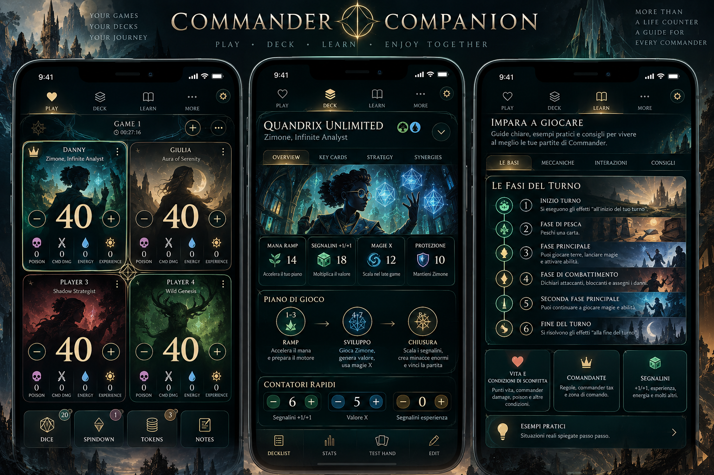

# Commander Companion — Canonical art direction

Status: **locked by the user**  
Date: 2026-10-18  
Reference image: [`canonical-reference-2026-10-18.png`](canonical-reference-2026-10-18.png)

Product translation board: [`canonical-compact-and-rules.svg`](canonical-compact-and-rules.svg)

## Authority

This image is the canonical reference for the visual identity of Commander Companion. It defines atmosphere, palette, typography, imagery, ornament and perceived production value.

The screens shown in the image are not literal product requirements and do not replace approved information architecture, interaction behavior, accessibility requirements or responsive geometry. When a written art-direction note conflicts with the visual language shown here, this reference wins.

Order of precedence:

1. approved product specifications for behavior, content and accessibility;
2. this canonical reference for visual identity;
3. [`../ART_DIRECTION_AND_MOTION.md`](../ART_DIRECTION_AND_MOTION.md) for detailed visual and motion implementation;
4. existing tokens and component defaults where they do not conflict with the first three items.

## Core visual identity

Commander Companion is a **premium dark-fantasy editorial companion**, not a generic dark dashboard.

Its defining signals are:

- ink-black and deep blue-green surfaces;
- warm antique-gold borders, typography and active states;
- luminous teal as magical energy and structural light;
- warm ivory for life totals and important reading text;
- elegant high-contrast serif display typography;
- cinematic fantasy illustration integrated into the interface;
- fine arcane linework, constellations and geometric sigils;
- layered composition with strong framing and controlled glow;
- small-caps or letter-spaced navigation that feels editorial rather than utilitarian.

The intended impression is **mythic, refined, immersive and legible**. Richness comes from art, typography and linework—not from adding more controls or wrapping every item in a card.

## Translation to the product

### Scoring surface

- Life remains the dominant datum and may use the warm ivory/gold serif treatment visible in the reference.
- Player panels may incorporate darkened character/world artwork or atmospheric textures when that feature is available.
- Artwork must sit behind a contrast veil so names, life totals and controls remain immediately readable.
- Use fine gold frames and restrained teal edge light instead of generic gray rounded-card borders.
- Player colors remain identifiers, not full-panel fills.
- Utility controls stay compact; the visual richness belongs to the panel atmosphere and hierarchy, not to larger chrome.

Final crop and veil decision:

- player art is full-bleed `cover`, never `contain` or letterboxed;
- default focal point is 50% x / 32% y, with per-art focal overrides;
- faces and primary subjects stay in the central upper safe zone;
- a deep-ink/teal layered veil progresses from approximately 24% at the top to 88% at the bottom, with local top-edge protection behind the name and details control;
- life, names and actionable controls target at least 4.5:1 after compositing;
- when contrast fails, strengthen the veil rather than adding heavy text glow.

The complete implementation values and rules-band variant are defined in [`../CANONICAL_VISUAL_GAP_REVIEW.md`](../CANONICAL_VISUAL_GAP_REVIEW.md), section C2.1.

### Rules and learning surfaces

- Treat rules as an illustrated editorial guide: serif section titles, gold numbering, teal/gold timeline cues and selective scenic imagery.
- Keep the approved continuous reading structure. The reference does not authorize turning every rule into an isolated card.
- Use artwork as an anchor or band, not behind dense body copy.
- Body text must remain highly legible and quieter than headings.

### Navigation and chrome

- Selected states use a warm gold underline, halo or fine framed treatment.
- Icons are thin, bespoke-feeling line icons in gold, ivory or muted teal.
- Major screen titles use the display serif; dense controls and explanatory text may use the legible utility face.
- Avoid default-looking gray buttons and repeated undifferentiated rounded rectangles.

## Typography rule

Use two complementary roles:

- **Display serif:** brand, major section headings, player names where space permits, life totals and editorial numerals.
- **Utility face:** compact buttons, form controls, references, long explanatory copy and accessibility-critical microcopy.

The display serif is part of the identity and must not be removed in favor of an all-system-sans interface. Conversely, it must not reduce glanceability at compact sizes.

## Motion translation

Motion should feel like controlled arcane illumination:

- active navigation may ignite with a brief gold underline/halo;
- sheets and popovers retain the approved 140–220ms directional transitions;
- score changes remain fast and local;
- low-contrast sigils or linework may move very slowly as ambient atmosphere;
- one-shot light blooms are acceptable for meaningful state changes when subtle.

Do not use celebratory particles, game-launcher explosions, elastic motion or continuous high-contrast pulsing. Reduced-motion mode remains state-equivalent and effectively instant.

## Failure conditions

Reject a visual implementation if it:

- looks like a generic dark SaaS dashboard;
- removes serif display typography entirely;
- replaces cinematic atmosphere with flat gray cards;
- uses teal and gold only as tiny functional accents with no authored visual world;
- lets artwork interfere with scores or body text;
- becomes parchment-themed, medieval-cartoonish, casino-like or visually noisy;
- copies the reference screen layout while ignoring the approved product behavior.

## Review shorthand

When evaluating future work, ask:

> Does this feel like the same premium, illustrated, gold-and-teal Commander world as the canonical reference while preserving the speed and legibility of a shared tabletop tool?

If the answer is only “it is dark and usable,” the art direction is not yet complete.
